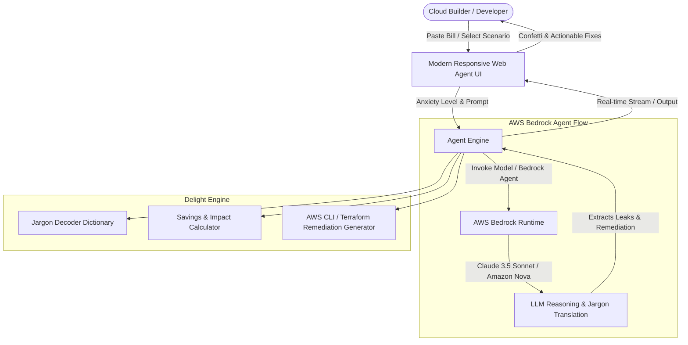

# CostWhisperer 💸➡️🛡️
> **The AWS Bill Translator & Cost Leak Diagnostic Agent that people actually enjoy using.**

[](https://aws.amazon.com/bedrock/)
[](https://builder.aws.com/)
[](LICENSE)
[](https://vishwajeetcse.github.io/CostWhisperer/)

> 🏆 Built for the **AWS Builder Center Weekend Challenge: "Build an agent people actually enjoy using"** (#agents).

---

## 🌟 The Problem: AWS Bill Anxiety is Real
Ever opened your monthly AWS bill and stared at line items like:
- `AWS-Cost-Explorer-Request` ($0.01 per request adding up?)
- `AmazonEC2 - NatGateway-Bytes ($0.045/GB + $0.045/hour)`
- `EBS:VolumeUsage.gp2` attached to stopped instances
- `DataTransfer-Regional-Bytes` across Availability Zones

Most cost optimization tools spit out dry multi-tab CSV exports or overwhelming dashboard charts that make you feel guilty without showing you *exactly* how to fix the problem in 2 minutes.

---

## 💡 What is CostWhisperer?
**CostWhisperer** is an interactive, empathetic AI agent built with **AWS Bedrock**. It translates cryptic AWS billing jargon into plain English, instantly detects silent cost leaks (NAT Gateways, idle provisioned IOPS, unattached Elastic IPs, cross-AZ transfers), and provides **one-click AWS CLI remediation scripts** with gamified savings achievements.

### 💖 The "Delightful Details"
What makes CostWhisperer fun and engaging instead of another boring enterprise dashboard?
1. **The AWS Bill Anxiety Meter 😰➡️😌**: An interactive slider reflecting your bill shock that adjusts the agent's tone from *"Emergency triage mode"* to *"Zen cloud architect"*.
2. **Plain English "Jargon Decoder"**: Hover or click on any cryptic AWS SKU to see a human explanation (*e.g., "NAT Gateway: You're paying AWS a toll tax just to let private EC2 instances download npm packages"*).
3. **Interactive Pre-Loaded Scenarios**: No AWS bill on hand? Choose between *The Startup Surprise ($1,420/mo NAT leak)*, *The Dormant Dev Playground ($420/mo abandoned EBS/EIPs)*, or *The Cross-AZ Chatty Microservice ($890/mo data transfer)*.
4. **One-Click CLI Fixes & Confetti Savings Counter**: Click to copy the exact AWS CLI or Terraform fix snippet, watch your estimated monthly savings counter tick up, and celebrate with a confetti burst! 🎉
5. **Dual Mode (AWS Bedrock Live API or Instant Interactive Mock)**: Test it live without needing AWS credentials, or plug in your Amazon Bedrock credentials to analyze your real AWS Cost and Usage Reports (CUR).

---

## 🏗️ Architecture



- **Frontend**: Clean, zero-dependency modern vanilla web app (compatible with GitHub Pages, AWS Amplify, or S3 CloudFront).
- **AI Brain**: Amazon Bedrock Foundation Models (Claude 3.5 Sonnet / Amazon Nova Micro & Pro) with structured system prompt persona.
- **Remediation Database**: Curated rules for Top 10 silent AWS billing leaks.

---

## 🚀 Quick Start / Try It Out

### 1. Live Demo (GitHub Pages)
Visit the live hosted web application at:
👉 **[https://vishwajeetcse.github.io/CostWhisperer/](https://vishwajeetcse.github.io/CostWhisperer/)**

### 2. Local Setup
Clone this repository and open `index.html` in your browser:

```bash
git clone https://github.com/VishwajeetCSE/CostWhisperer.git
cd CostWhisperer
# Open in browser (or use live-server / python http.server)
python -m http.server 8000
```
Open `http://localhost:8000` in your browser.

---

## 🛠️ Built With
- **AWS Bedrock** (Anthropic Claude 3.5 Sonnet / Amazon Nova)
- **AWS CLI Scripts & Remediation Presets**
- **HTML5, Modern CSS3 & Vanilla JavaScript** (Zero build dependencies, ultra-fast load time)
- **Canvas-Confetti** for celebration feedback

---

## 👨‍💻 Author & Contest Submission
- **Author**: Vishwajeet ([@VishwajeetCSE](https://github.com/VishwajeetCSE))
- **AWS Builder Center Article**: [CostWhisperer: An AWS Bill Translator & Cost Leak Agent People Actually Enjoy Using](https://builder.aws.com/content/3KXeHpvanNOD1VniwdIzXFtvavP/costwhisperer-an-aws-bill-translator-and-cost-leak-agent-people-actually-enjoy-using)
- **Challenge Tag**: `#agents`
- **License**: MIT
